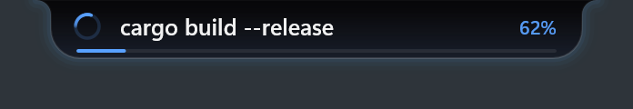
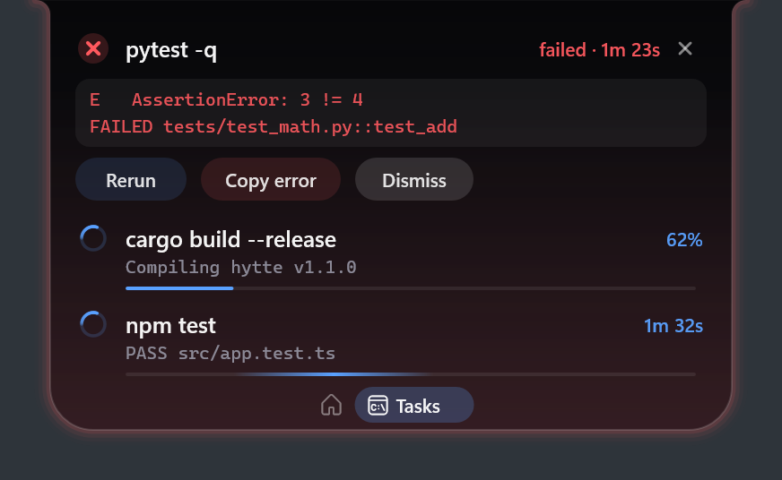
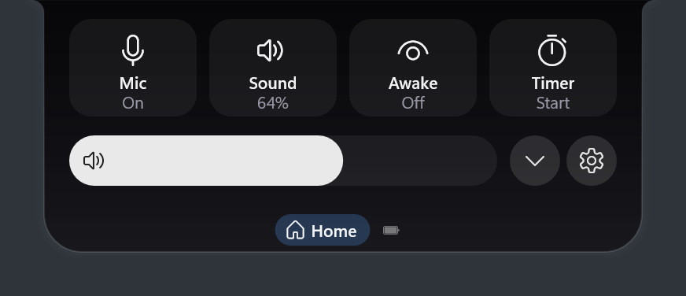
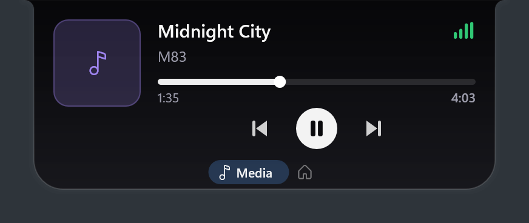
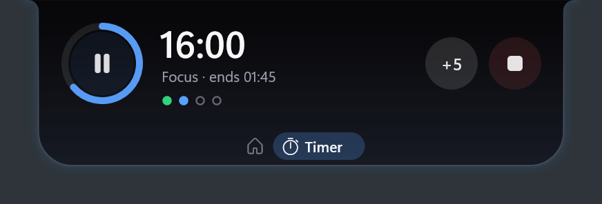
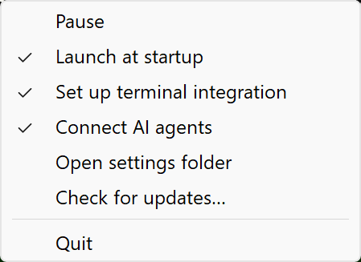
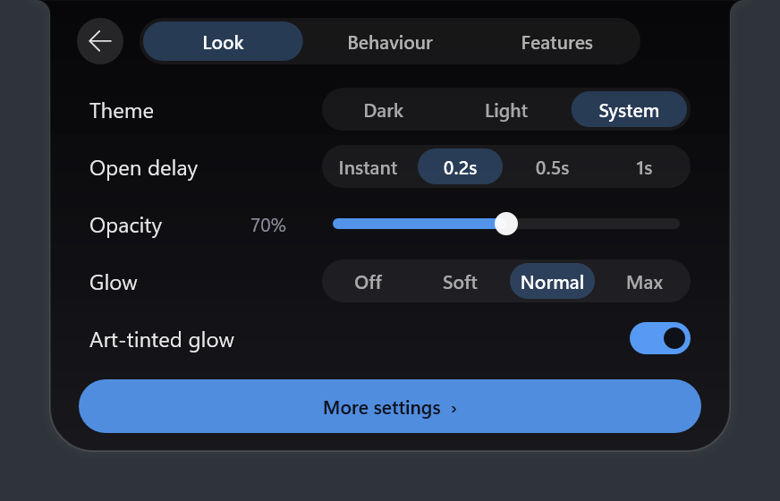
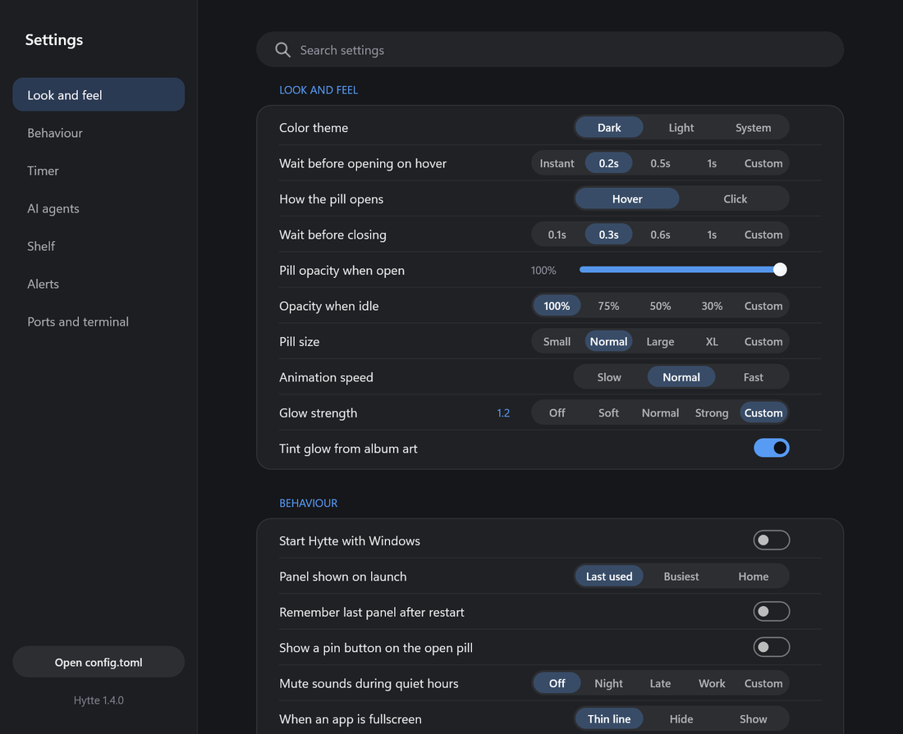
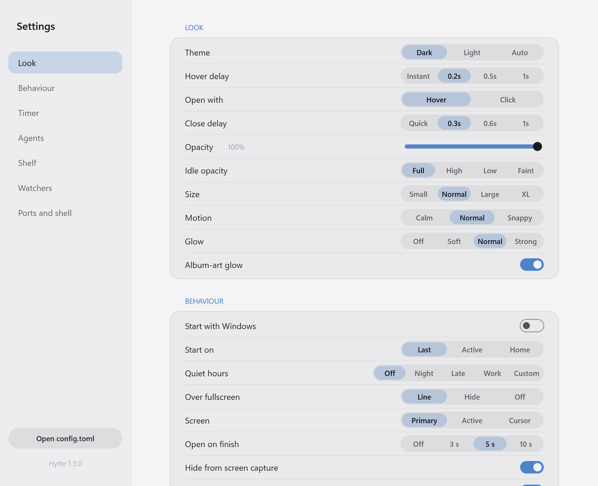

<p align="center">
  
</p>

# Hytte

**A smart little notch for the top of your Windows 11 screen.**

Hytte puts a small pill at the top-centre of your screen. It stays quiet until something worth knowing happens: a build finishes, an AI agent needs your answer, a dev server starts, music plays, or you drag a file toward the top. Then it opens, shows what matters, and tucks itself away.

It never steals focus, idles at almost no CPU, and uses under 20 MB of RAM. It is one small program, `hytte.exe`, which is both the pill and the `hytte` command in your terminal.

**New here? Read the [manual](manual/README.md).**

<p align="center">
  <br>
  
</p>

## What it does

- **Watches long commands.** Spinner, timer, then a tick or a cross. The latest output line shows under a running command; a failed one has **Copy error** and **Rerun**.
- **Follows AI agents.** Claude Code, Codex, OpenCode, Gemini CLI, Antigravity and Cursor appear by name with their current step. When one waits for you the pill turns amber (even over a maximised terminal) and one click takes you to its terminal. A finished agent shows a card with its first reply line and **Copy**.
- **Answers permission prompts.** Claude Code, Codex and OpenCode permission requests show the command with **Allow** and **Deny**.
- **Shows dev servers.** Anything on `localhost:3000`, `5173`, `8080` and friends appears with **Open**, **Stop** and, for servers started from a tracked command, **Restart**.
- **Holds files (the shelf).** Drop files or text on the pill, switch windows, drag them back out. Win+Shift+S screenshots land there too.
- **Quick file actions.** Shrink an image, make a PDF, strip location data, OCR, tidy JSON, decode a JWT, timestamp, base64, URL or hex colour, make a QR code.
- **Controls music**, with a draggable timeline, lyrics and a sleep timer ("stop playing in 30 min") that fades the volume out.
- **Quick controls.** Mute all microphones (red lock on the pill), mute speakers, keep the PC awake, per-app volume.
- **Timer and focus sessions.** Countdown or Pomodoro. A focus session turns on Windows Do Not Disturb, holds Hytte's own alerts and tells you what you missed in one line; collapsed, it shows as a thin line along the pill.
- **Notes and a to-do list.** Type something and press Enter; a note lasts 24 hours or is kept. A hotkey opens Notes with the cursor ready.
- **Weather.** Pick a town (suggestions as you type) and see now plus the next hours. Nothing is fetched while the pane is closed.
- **Break reminders.** Eyes (20-20-20), stretch and water nudges as a small card on the pill, never a popup, and never in a meeting, a game or a focus session.
- **Skins.** Five colour themes for the pill.
- **Alerts.** Browser downloads, runaway CPU or memory hogs (**Kill** / **Ignore**), your next meeting (optional, **Join** button), camera and mic dots, battery and power mode on laptops.
- **Gets out of the way.** A game or fullscreen app makes it vanish and stop touching input (no FPS cost). A maximised or snapped window, or fullscreen video, shrinks it to a hairline.
- **Safe to share.** One setting (`hide_from_capture`) keeps it out of screenshots, recordings and calls, and tokens or passwords in a command show as `•••`. New installs show the pill in screenshots; installs from before 1.7 keep whatever they had.
- **Updates itself** in place, and **`hytte doctor`** tells you what's set up and how to fix what isn't.

## Install

You need **Windows 11 (22H2 or newer, 64-bit)**.

1. Download `hytte.exe` (or `hytte-<version>-x64.zip`) from the [latest release](https://github.com/PrathamPai-2007/hytte/releases/latest).
2. Put it somewhere permanent and writable, such as `C:\Tools\Hytte\hytte.exe` (not `Program Files`: Hytte updates itself there).
3. Run it. The pill appears and a tray icon is added. Hytte also puts its folder on your `PATH`, so `hytte` works in terminals you open from now on.
4. Tray icon → **Set up terminal integration** (tracks your commands) and **Connect AI agents** (if you use them). Tick **Launch at startup** if you want it on every sign-in.

<details>
<summary>Build it yourself instead</summary>

Install [Rust](https://rustup.rs) and the Visual Studio Build Tools ("Desktop development with C++"), then:

```powershell
git clone https://github.com/PrathamPai-2007/hytte.git
cd hytte
cargo build --release     # hytte.exe ends up in target\release\
```

The [developer docs](docs/02-getting-started.md) cover the rest.
</details>

## A five-minute tour

**1. Hover the pill.** It opens; move away and it closes (click-to-open is a setting). Swipe sideways, scroll, or click the icons along the bottom to switch panes: Shelf, Media, Home (quick controls), Tasks, Timer, and Power on laptops.

**2. Track a slow command.**

```powershell
hytte run -- npm run build
```

Your command runs as normal and keeps its exit code. A percentage in its output (`45%`) turns the spinner into a progress bar. Some tools only print progress in a real terminal: use `hytte run -- git clone --progress <url>`. Use `--no-progress` to ignore percentages.

**3. Track every slow command automatically.** Tray → **Set up terminal integration** (or `hytte setup`), then open a new terminal. Anything over 3 seconds now shows up without the prefix. Editors and pagers (`vim`, `less`, `ssh`…) are ignored.

**4. Park a file.** Drop it on the pill, drag it out later. Click a file on the shelf for its actions.

**5. Start a timer.** Home → **Timer**, pick minutes, **Start timer** or **Start focus**. Right-clicking the pill opens the same card.

## What the pill is telling you

| You see | It means |
|---|---|
| Small dark capsule | Nothing is happening. |
| Spinner and timer | A task is running. |
| Green tick / red cross | A task finished / failed (a cross stays until dismissed). |
| Amber glow and a bell | Something, usually an AI agent, is waiting for you. Click it. |
| `● :3000` | A dev server is running on that port. |
| Stacked tiles and a number | Files are on your shelf. |
| Album art and moving bars | Music is playing. |
| Red lock | Microphones are muted. |
| Green / orange dot | An app is using your camera / microphone. |
| Small second pill | A running timer, or music while a task runs. |
| Amber `!` card / blue `i` card | A resource hog / your next meeting. |
| Battery that fills / drains | You plugged in / unplugged the charger. |
| Thin grey line | A maximised or snapped window, or fullscreen video, is under the pill. Hover to bring it back. |
| Green bell card | A timer finished. The alarm rings until **Stop alarm** (2 minutes at most). |

| Idle | Quick controls | Music | Timer |
|---|---|---|---|
|  |  |  |  |

Click a task to jump to its terminal (the right Windows Terminal tab too). Click album art to raise the music app. **Stop** and **Kill** ask twice. Click the timer ring to pause it.

### The tray icon



Click it for: **Pause**, **Launch at startup**, **Set up terminal integration**, **Connect AI agents** (choose either again to remove), **Move to next monitor**, **Open settings folder**, **Check for updates…**, **Help** and **Quit**.

<br clear="right">

## Common setups

### Terminal integration

Easiest: tray → **Set up terminal integration**, or `hytte setup` (add `--undo` to remove). It edits your PowerShell and Git Bash profiles. By hand, add one line and open a new terminal:

| Shell | Line | File |
|---|---|---|
| PowerShell | `hytte init pwsh \| Out-String \| Invoke-Expression` | `$PROFILE` |
| bash / Git Bash | `eval "$(hytte init bash)"` | `~/.bashrc` |
| zsh | `eval "$(hytte init zsh)"` | `~/.zshrc` |
| Nushell | `hytte init nu \| save -f ~/.config/nushell/hytte.nu`, then `source` it | `config.nu` |

With Starship: in bash put the line *before* `starship init`; in PowerShell, *after*. If PowerShell says scripts are disabled, run `Set-ExecutionPolicy -Scope CurrentUser RemoteSigned` once.

### AI agents

Tray → **Connect AI agents**, or `hytte setup agents`. Hytte adds small hooks to each installed agent:

| Agent | Pill shows | Hook file |
|---|---|---|
| Claude Code | working, step, waiting, done, **Allow / Deny** | `~/.claude/settings.json` |
| Codex | working, step, done, **Allow / Deny** | `~/.codex/hooks.json` |
| OpenCode | working, waiting, done, **Allow / Deny** | `~/.config/opencode/plugins/hytte.js` |
| Gemini CLI | working, waiting, done | `~/.gemini/settings.json` |
| Antigravity | working, done | `~/.gemini/config/hooks.json` |
| Cursor | working, done | `~/.cursor/hooks.json` |

Restart running agents. In Codex, type `/hooks` once to trust them. Your own settings are kept, the original is saved as `<file>.hytte-backup`, and `hytte setup agents --undo` removes the hooks.

**Allow / Deny** appears over any window. Long or multi-line commands say so ("2 lines, see terminal"), so check the terminal first. With no answer in 30 seconds, the agent's own prompt appears in the terminal.

Other tools can call `hytte agent needs-input --name "MyTool" --message "waiting"` and `hytte agent done --name "MyTool"`.

### Scripts

```powershell
hytte set --progress 40 --label "Uploading" --task upload-1   # same --task updates one entry
hytte set --done --task upload-1                              # green (--fail for red)
hytte notify "Backup finished"                                # a card on the pill
hytte shelf add .\report.pdf                                  # or: git diff | hytte shelf add
hytte ports                                                   # list dev servers
hytte kill :3000                                              # stop what's on port 3000 (asks first)
hytte doctor                                                  # check your setup; exits 1 on a problem
```

## Updating

Hytte checks a minute after start and then daily. A card offers **Update** or **Later**. Update downloads `hytte.exe`, checks it reports the expected version, swaps it in place and restarts; your settings, shelf and setup are kept. **Check for updates…** in the tray checks now; `check_updates = false` turns the automatic check off. Only `api.github.com` and `github.com` are contacted and nothing about you is sent. If the folder isn't writable, replace `hytte.exe` yourself from the [releases page](https://github.com/PrathamPai-2007/hytte/releases).

`hytte.exe` itself isn't code-signed, so SmartScreen may warn the first time you run a download.

Coming from before 1.0 (`notch.exe`)? Quit the old Hytte, replace `hytte.exe`, delete `notch.exe`, start it, choose **Connect AI agents** again if you pasted hooks by hand, and use `hytte` where you used `notch`.

## Settings

The **gear** beside the volume bar on Home opens the settings pane (theme, hover delay, opacity, glow, fullscreen behaviour, screen, autostart and feature switches). Its top-right button opens the **settings window**: every setting, searchable, with explanations on hover, a **Custom** step for values the presets lack, and a **↺** to reset anything changed.

<p align="center">
  
</p>

<p align="center">
  
  
</p>

Everything lives in `%APPDATA%\Hytte\config.toml` (tray → **Open settings folder**). Every setting is optional, most apply as soon as you save, and a mistake keeps your previous settings and shows a card with the line and column. A few common ones:

```toml
[general]
theme = "auto"            # "dark", "light" or "auto"
monitor = "primary"       # "primary", "active", "cursor" or a number
hotkey = ""               # e.g. "Win+Alt+N": opens the pill for keyboard use
open_on = "hover"         # or "click"
fullscreen = "line"       # "line", "hide" or "off" (games always hide)
hide_from_capture = false # true keeps the pill out of screenshots and screen share
quiet_hours = ""          # no sounds, e.g. "22:00-07:00"
note_hotkey = ""          # e.g. "Win+Alt+J": opens Notes with the cursor ready
skin = "graphite"         # "graphite", "aurora", "ember", "moss" or "dusk"
allow_list = []           # apps that never make Hytte back off
deny_list = []            # apps that always get game mode

[shell]
threshold_ms = 3000       # how long a command must run before it shows

[ports]
watch = [3000, 3001, 4200, 5000, 5173, 5432, 8000, 8080, 8888]
show_all = false

[calendar]
enabled = false           # off by default: event titles are private

[panes]
notes = true              # tabs in the pill; switch any off
todo = true
weather = true

[weather]
units = "auto"            # "auto" (follow Windows), "metric" or "imperial"

[media]
lyrics = false            # looks songs up on lrclib.net (sends title and artist)

[breaks]
eyes_min = 0              # minutes between reminders; 0 = off
stretch_min = 0
water_min = 0

[timer]
focus_dnd = true          # a focus session turns on Windows Do Not Disturb
```

**Keyboard:** set `hotkey`, press it, then **Left / Right** switch panes, **Tab** highlights buttons, **Enter** presses, **Esc** closes and returns focus.

Every setting, and which need a restart, is in the [configuration guide](docs/11-configuration-and-files.md). Changes per version are in [What's new](docs/16-whats-new.md).

## Troubleshooting

Start with `hytte doctor`: it checks the pill, `PATH`, terminals, agents and `config.toml` and says how to fix each problem. Logs are in `%APPDATA%\Hytte\hytte.log`.

| Problem | Try this |
|---|---|
| Nothing happens on start | It's probably already running (check the tray). Only one copy runs. |
| I can't see the pill | A game or fullscreen app is in front, a maximised or snapped window shrank it to a thin line (hover it, or set `fullscreen = "off"`), or Hytte is paused in the tray. |
| `hytte: daemon not running` | Run `hytte`. Your command still ran. |
| `hytte` isn't recognised, or old terminals show no tasks | Open a **new** terminal (old ones keep the old `PATH` and, after 1.6.0, the old pipe). Or run `.\hytte.exe setup`. |
| `notch` isn't recognised | The command is `hytte` now. |
| An agent never shows up | Tray → **Connect AI agents**, restart the agent, and in Codex trust the hooks with `/hooks`. |
| Commands don't show up | Set up terminal integration and open a new terminal. Commands under 3 seconds are hidden on purpose. |
| A task failed after Ctrl+C | Ctrl+C counts as "you stopped it". If you still see it, open a **new** terminal to get the current hook. |
| "The update didn't install" | The folder is probably read-only: move `hytte.exe` under your user folder or update by hand. |
| `config.toml` warning card | Click it to open the file at the line, or the unknown (usually misspelt) setting. Previous settings stay in force meanwhile. |
| A port isn't listed | Add it to `[ports] watch`, or set `show_all = true`. |
| The hotkey does nothing | Another app may own it, or it has no modifier. Try `"Ctrl+Alt+H"`. |
| A resource warning I don't want | **Ignore** it, raise `[hog] cpu_pct` / `mem_mb`, or set `[hog] enabled = false`. |
| "OCR unavailable" | Install a language pack in *Settings → Time & language → Language & region*. |
| No music controls | The player must report itself to Windows (most browsers and players do). |
| Console window flashes at start | Windows 11 before 24H2; it closes by itself. |
| Pill flickers on hover | Seen on some setups, possibly Windows itself. Open an issue with your Windows version and graphics driver. |

## Good to know

- **Games.** When any app is truly fullscreen, Hytte enters *game mode*: it hides with no fade, removes its mouse hooks, releases its hotkey, drops to background priority and pauses its checks. It returns as soon as you leave, and notifications wait for you. If a game isn't detected, add its exe to `deny_list`; `hytte.log` shows what Hytte decided.
- **Fullscreen video** gets the thin line only, so the tabs and controls around it stay clickable.
- Images dragged straight from a **browser** aren't supported yet; save them first.
- Dropping files works on the monitor the pill is on.

## For developers

See the [developer documentation](docs/README.md).

## License

MIT. See [LICENSE](LICENSE).
