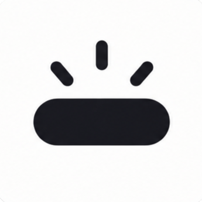

<p align="center">
  
</p>

# Hytte

**A smart little notch for the top of your Windows 11 screen.**

Hytte puts a small pill at the top-centre of your screen. It stays quiet until something worth knowing happens: a build finishes, an AI agent needs your answer, music plays, a timer ends, or you drag a file toward the top. Then it opens, shows what matters, and tucks itself away.

It never steals focus, idles at almost no CPU, and uses about 10 MB of RAM. It is one small program, `hytte.exe`, which is both the pill and the `hytte` command in your terminal.

<p align="center">
  <br>
  
</p>

## What it does

- **Watches long commands.** Spinner, timer, then a tick or a cross, with **Copy error** and **Rerun** when one fails.
- **Follows AI agents** (Claude Code, Codex, OpenCode, Gemini CLI, Antigravity, Cursor). The pill turns amber when one needs you, and permission requests get **Allow** and **Deny** buttons.
- **Shows dev servers** on common ports, with **Open**, **Stop** and **Restart**.
- **Holds files** while you switch windows (the shelf), with one-click image, PDF, text and QR tools. Win+Shift+S screenshots land there too.
- **Plays music for you:** controls, a timeline, lyrics that follow the song, and a sleep timer.
- **Quick controls:** mute microphones and speakers, keep the PC awake, per-app volume.
- **Timer and focus sessions** that switch on Windows Do Not Disturb and tell you what you missed.
- **Live cards from your scripts:** progress, icons and buttons, and `--wait` to ask a question and get the answer back.
- **Your own panes,** filled by a command Hytte runs while the pane is open, or by your scripts.
- **Notes, a to-do list and the weather**, typed straight into the pill.
- **Break reminders** for your eyes, your back and your water bottle.
- **Alerts** for downloads, runaway CPU or memory, your next meeting, camera and microphone use, and battery.
- **Gets out of the way** of games and fullscreen apps, and can stay out of screenshots and screen shares.
- **Updates itself.** Six colour skins, one following your Windows accent colour, and every pane can be switched off or reordered.

## Install

You need **Windows 11 (22H2 or newer, 64-bit)**.

1. Download `hytte.exe` from the [latest release](https://github.com/PrathamPai-2007/hytte/releases/latest).
2. Put it somewhere permanent that you can write to, such as `C:\Tools\Hytte\hytte.exe` (not `Program Files`: Hytte updates itself in place).
3. Run it. The pill appears and a tray icon is added.
4. Tray icon → **Set up terminal integration** (tracks your commands) and **Connect AI agents** (if you use them).

`hytte.exe` isn't code-signed, so SmartScreen may warn the first time: choose **More info**, then **Run anyway**.

<details>
<summary>Build it yourself instead</summary>

Install [Rust](https://rustup.rs) and the Visual Studio Build Tools ("Desktop development with C++"), then:

```powershell
git clone https://github.com/PrathamPai-2007/hytte.git
cd hytte
cargo build --release     # hytte.exe ends up in target\release\
```
</details>

## Try it

```powershell
hytte run -- npm run build        # watch one command on the pill
hytte notify "Backup finished"    # a card from your own script
hytte card --title "Deploy" --progress 40 --id deploy   # a live card you can update
hytte doctor                      # check your setup and how to fix it
```

Point at the pill to open it. Drop a file on it to park it. Right-click it for a timer.

## Learn more

- **[The manual](manual/README.md)**: every feature, setting and fix, in plain language.
- **[Developer docs](docs/README.md)**: how Hytte works inside, and how to change it.
- **[What's new in 1.7](docs/16-whats-new.md)**
- **[Issues](https://github.com/PrathamPai-2007/hytte/issues)**: something wrong or missing?

## License

MIT. See [LICENSE](LICENSE).
