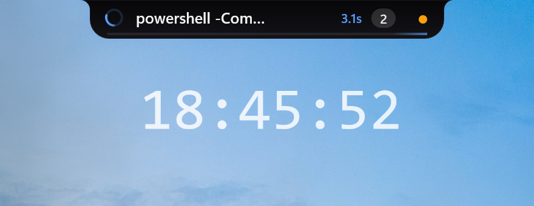
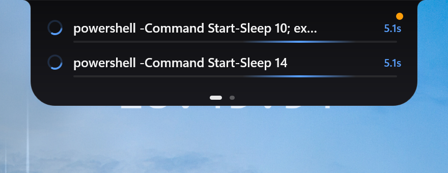
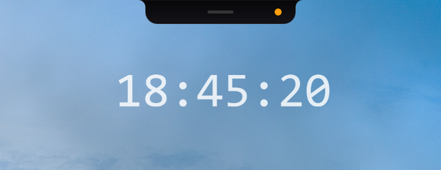
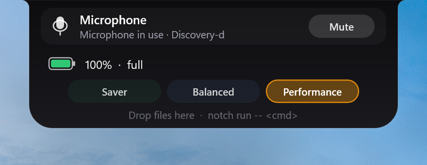
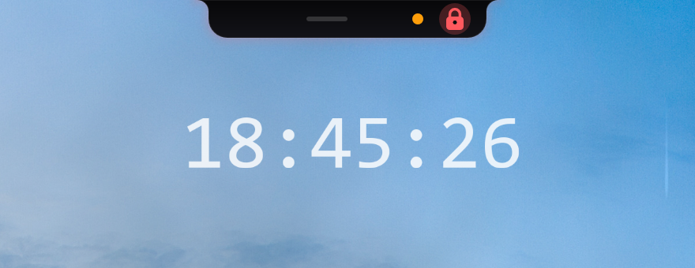
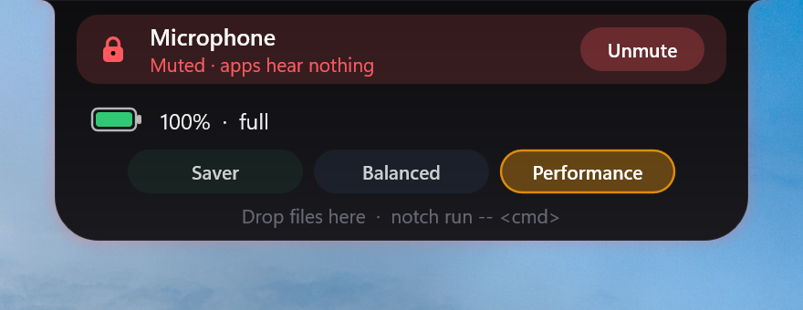
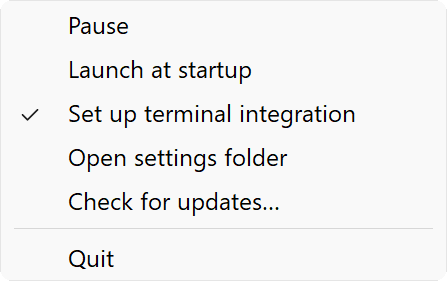
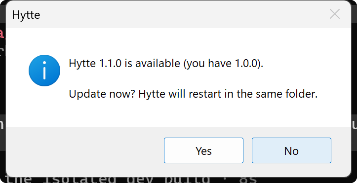

<p align="center">
  
</p>

# Hytte

**A smart little notch for the top of your Windows 11 screen.**

Hytte puts a small pill at the top-centre of your screen. It stays quiet until something worth knowing happens: a build finishes, an AI agent needs your answer, a dev server starts, music plays, or you drag a file toward the top of the screen. Then it opens, shows you what matters, and tucks itself away again.

It never steals focus from what you're typing, and it uses almost no CPU while idle and under 20 MB of RAM (about 10 MB committed, measured). It's one small program, `hytte.exe`, which is both the pill and the command you type in your terminal.

<p align="center">
  <br>
  
</p>

## What it can do

- **Watch long commands.** See when a build, test run or download finishes, and whether it failed, without staring at the terminal. A running command's latest output line shows under it.
- **Follow your AI agents.** Claude Code, Codex, OpenCode, Gemini CLI, Antigravity and Cursor show up by name with what they're doing right now ("Editing render.rs"). When one is waiting for you the pill turns amber, even over a maximised terminal, and one click takes you to the right terminal. One click in the tray connects them all.
- **Answer permission prompts from the pill.** When Claude Code, Codex or OpenCode asks to run something, the pill shows the command with **Allow** and **Deny**, so you don't have to switch windows.
- **Show your dev servers.** Anything listening on `localhost:3000`, `5173`, `8080` and friends shows up under your tasks, with **Open** and **Stop** buttons. A server you started from a terminal is labelled with that command, and clicking it takes you to the terminal.
- **Hold files for you (the shelf).** Drag files or text onto the pill, switch windows or desktops, then drag them back out wherever you need them.
- **Quick file actions.** Shrink an image under 5 MB, turn it into a PDF, strip its location data, copy the text out of it, or tidy up JSON. One click each.
- **Control music.** See what's playing and skip or pause.
- **Quick controls.** One pane of tiles: mute every microphone at once (with a red lock on the pill so you always know), mute the speakers, keep the PC awake (an hour, or until you turn it off), and the timer. Under them a volume bar you can drag, click or scroll.
- **Timer and focus sessions.** Start a countdown or a Pomodoro from the **Timer** tile (or right-click the pill). The running timer is a ring you click to pause, with its end time, the focus rounds as dots, **+5** and **Stop**; collapsed, it burns down as a thin fuse along the pill, and splits off as a small clock beside a task or music. When it ends, an alarm rings until you stop it (two minutes at most).
- **Browser downloads.** A download in progress is a task with its growing size; when it finishes you get **Open** and **Shelve**.
- **Runaway processes.** If one program keeps a lot of CPU or memory for a while, the pill says so, with **Kill** (asks twice) and **Ignore**.
- **Your next meeting** (optional). A heads-up a few minutes before it starts, with **Join** for Teams, Meet and Zoom links.
- **Keyboard and looks.** A global hotkey opens the pill for arrow keys and Tab; light, dark or follow-Windows themes; the glow takes the album art's colour; the pill can follow you to another monitor.
- **Battery and power mode** on laptops, on their own pane: charge, what the battery is doing, the time left, and Saver / Balanced / Performance.
- **Camera and mic dots** that tell you when an app is using them.
- **Gets out of the way of games and videos.** While a game or other fullscreen app is in front, Hytte vanishes completely and stops touching your input, so it costs no FPS or input lag. A maximised window, or a video playing fullscreen in a browser or player, just shrinks it to a hairline.
- **Stays out of screen share** if you want: one setting keeps the pill out of screenshots, recordings and calls.
- **Keeps itself up to date.** When a new version is out, Hytte asks once and updates itself in place.

## Install

You need **Windows 11 (22H2 or newer, 64-bit)**.

1. Download `hytte.exe` (or the `hytte-<version>-x64.zip`) from the [latest release](https://github.com/PrathamPai-2007/hytte/releases/latest).
2. Put it somewhere permanent, for example `C:\Tools\Hytte\hytte.exe`. Hytte updates itself in that folder, so pick one you can write to (your user folder is fine; `Program Files` isn't).
3. Run `hytte.exe`. The pill appears at the top of your screen and the Hytte icon appears in the system tray. Hytte also adds its folder to your `PATH`, so the `hytte` command works in any terminal you open from now on.
4. Click the tray icon and choose **Set up terminal integration**. This makes your terminal report long-running commands to the pill (see [Track every command automatically](#track-every-command-automatically)).
5. Using AI coding agents? Choose **Connect AI agents** in the same menu (see [Follow your AI agents](#follow-your-ai-agents)).

To start Hytte automatically, click the tray icon and tick **Launch at startup**.

<details>
<summary>Build it yourself instead</summary>

Install [Rust](https://rustup.rs) and the Visual Studio Build Tools ("Desktop development with C++"), then:

```powershell
git clone https://github.com/PrathamPai-2007/hytte.git
cd hytte
cargo build --release
```

`hytte.exe` ends up in `target\release\`. The [developer docs](docs/02-getting-started.md) cover the rest.
</details>

### One program, two jobs

Run `hytte` with nothing after it and you get the pill. Run it with a command and it's a terminal tool that talks to the pill:

```powershell
hytte                      # start the pill (does nothing if it's already running)
hytte run -- npm test      # run a command and show it on the pill
hytte help                 # every command
hytte --version
```

Typing `hytte` in a terminal hands you your prompt straight back; the pill keeps running on its own.

## A five-minute tour

**1. Hover the pill.** Rest your mouse on it and it opens. Move away and it closes. It opens on the quick controls, unless it is showing a task or music, which open their own pane. Scroll over it to flip between panes, or click the dots along the bottom. Left to right: Shelf, Media, the quick controls, Tasks (and dev servers), Timer, and Power on laptops.

**2. Track a slow command.** Put `hytte run --` in front of anything:

```powershell
hytte run -- npm run build
```

You'll see a spinner and a timer, then a green tick or a red cross. If the command prints its progress (like `45%`), the pill shows a filling bar instead of a spinner. On failure, the last error lines appear with a **Copy error** button. Your command runs exactly as before and keeps its exit code; if the pill isn't running, `hytte run` starts it.

Some tools only print progress in a real terminal, so ask for it: `hytte run -- git clone --progress <url>`. To ignore percentages a command prints, use `hytte run --no-progress -- <cmd>`.

**3. Track every slow command automatically.** Choose **Set up terminal integration** in the tray menu, or add one line to your shell yourself (see [below](#track-every-command-automatically)). Anything that runs longer than 3 seconds then shows up without the `hytte run` prefix.

**4. Park a file.** Drag a file toward the top of the screen and drop it on the pill. Later, drag it back out of the pill into Explorer, an email or a chat window. Click a file on the shelf to see what you can do with it.

**5. Start a timer.** Open the quick controls (the pane the pill opens on), press **Timer**, pick the minutes (presets, − / +, or scroll), then **Start timer** or **Start focus**. Right-clicking the pill opens the same card.

## What the pill is telling you

| You see | It means |
|---|---|
| A small dark capsule | Nothing is happening. |
| A spinner and a timer | A task is running. |
| A green tick | A task finished fine. It disappears after a few seconds. |
| A red cross | A task failed. It stays until you dismiss it. |
| An amber glow and a bell | Something (usually an AI agent) is waiting for you. Click it. |
| `● :3000` | A dev server is running on that port. |
| A stacked-tiles icon with a number | Files are waiting on your shelf. |
| Album art and moving bars | Music is playing. |
| A red lock | Your microphones are muted. |
| A green or orange dot | An app is using your camera (green) or microphone (orange). |
| A small second pill beside it | A second thing is going on: a running timer (clock) or music playing while a task runs (album art). |
| An amber `!` card | A program keeps using a lot of CPU or memory. |
| A blue `i` card | Your next calendar event is about to start. |
| A green battery that fills | You just plugged in the charger. |
| An amber battery that drains (red when low) | You just unplugged it. |
| A thin grey line | A maximised window or a fullscreen video covers the screen; hover the line to bring the pill back. |
| A green bell card | A timer finished. The alarm rings until you press **Stop alarm** (two minutes at most). |

| Idle | Quick controls | Muted | Muted, opened |
|---|---|---|---|
|  |  |  |  |

**Clicking things:**
- Click a task to jump to the terminal it's running in. In Windows Terminal, the right tab is selected too. A dev server started from that terminal works the same way.
- Click the album art to bring the music app to the front.
- **Stop** on a dev server asks once ("Kill?"); click again within 3 seconds to confirm.
- Click the timer's ring to pause or resume it.
- On the quick controls, drag or click the volume bar, or scroll over it (or over **Sound**) to change the volume 2 % at a time. **Awake** goes Off → 1 hour → On.
- Hytte never takes keyboard focus away from what you're doing.

### The tray icon



The Hytte icon sits in the system tray. It's dark on a light taskbar and white on a dark one, and it switches by itself when you change themes. Click it (left or right) for the menu:

- **Pause** hides the pill until you untick it.
- **Launch at startup** starts Hytte when you sign in.
- **Set up terminal integration** adds the shell hook (choose it again to remove it).
- **Connect AI agents** hooks Hytte into the coding agents you have installed (choose it again to disconnect them).
- **Open settings folder** opens the folder with `config.toml` and the log.
- **Check for updates…** looks for a newer version right now.
- **Quit** closes Hytte.

<br clear="right">

## Common setups

### Track every command automatically

The easy way: click the tray icon and choose **Set up terminal integration**, or run `hytte setup`. Then open a new terminal. This adds the line to your PowerShell (5.1 and 7) and Git Bash profiles. Choosing it again, or running `hytte setup --undo`, removes the line.

To do it by hand, or for zsh and Nushell, add the line for your shell, then open a new terminal:

| Shell | Add this line | To this file |
|---|---|---|
| PowerShell | `hytte init pwsh \| Out-String \| Invoke-Expression` | `$PROFILE` |
| bash / Git Bash | `eval "$(hytte init bash)"` | `~/.bashrc` |
| zsh | `eval "$(hytte init zsh)"` | `~/.zshrc` |
| Nushell | run `hytte init nu \| save -f ~/.config/nushell/hytte.nu`, then add `source ~/.config/nushell/hytte.nu` | `config.nu` |

Using Starship? In bash, put the line *before* the `starship init` line. In PowerShell, put it *after*. `hytte setup` does this for you.

If Windows PowerShell says running scripts is disabled (or never loads the hook), Windows' default policy is blocking your profile. The tray setup offers to fix it; or run `Set-ExecutionPolicy -Scope CurrentUser RemoteSigned` once.

Commands under 3 seconds never show up, and editors and pagers such as `vim`, `less` and `ssh` are ignored, so the pill doesn't flicker.

### Follow your AI agents

Click the tray icon and choose **Connect AI agents**, or run `hytte setup agents`. Hytte finds the agents you have installed and adds a few small hooks to each one's settings:

| Agent | What the pill shows | Where Hytte adds it |
|---|---|---|
| Claude Code (terminal, desktop app, IDE) | working, current step, waiting, done, **Allow / Deny** | `~/.claude/settings.json` |
| Codex | working, current step, done, **Allow / Deny** | `~/.codex/hooks.json` |
| OpenCode | working, waiting, done, **Allow / Deny** | `~/.config/opencode/plugins/hytte.js` |
| Gemini CLI | working, waiting, done | `~/.gemini/settings.json` |
| Antigravity (`agy`, the IDE) | working, done | `~/.gemini/config/hooks.json` |
| Cursor | working, done | `~/.cursor/hooks.json` |

Restart agents that are already running. Codex asks you to approve new hooks once: type `/hooks` in Codex and trust them.

Your own settings and hooks are kept as they are, and the first time Hytte changes a file it saves the original next to it as `<file>.hytte-backup`. Choosing the tray item again, or running `hytte setup agents --undo`, takes Hytte's hooks out again. The hooks run `hytte.exe` by its full path; if you move Hytte, it fixes them the next time it starts.

**Allow / Deny.** When an agent wants to run something you haven't allowed yet, the pill opens with the command, even over a maximised window. If the command has several lines or is long, the pill says so first ("2 lines, see terminal"), so check the terminal before you allow it. The agent's own prompt appears in the terminal when the pill gets no answer (30 seconds), straight away if you press **Dismiss**, and at once while you're in a game or Hytte is paused.

Agents you start from a terminal show up under their own name instead of as a long-running command. For other tools, have them run `hytte agent needs-input --name "MyTool" --message "waiting for you"` when they need you, and `hytte agent done --name "MyTool"` when they finish.

### Report progress from a script

```powershell
hytte set --progress 40 --label "Uploading" --task upload-1
```

Use the same `--task` name each time to update one entry.

### Ports from the terminal

```powershell
hytte ports            # list dev servers
hytte kill :3000       # stop whatever is on port 3000 (asks first)
```

## Updating

Hytte checks for a new version about a minute after it starts and then once a day. When one is out, it asks:

<p align="center"></p>

Choose **Yes** and Hytte downloads the new `hytte.exe`, checks it's the version it expected, swaps it into the same folder and restarts. Your settings, shelf, autostart and terminal setup all stay as they are. Choose **No** and it won't ask about that version again, only about a newer one.

- To check right now, use **Check for updates…** in the tray menu.
- To turn the automatic check off, set `check_updates = false` in the settings. The tray item still works.
- The check only talks to GitHub (`api.github.com` and `github.com`), using Windows' own `curl.exe`. Nothing about you or your machine is sent.
- If Hytte lives in a folder you can't write to, it tells you and changes nothing. Download the new version from the [releases page](https://github.com/PrathamPai-2007/hytte/releases) and replace `hytte.exe` yourself.

## Upgrading from an older version (with `notch.exe`)

Before version 1.0, Hytte came as two programs: `hytte.exe` and a separate `notch.exe` for the terminal. Now `hytte.exe` does both, and the command is `hytte` instead of `notch` (`notch run -- …` becomes `hytte run -- …`). To upgrade:

1. Quit the old Hytte from the tray.
2. Replace the old `hytte.exe` with the new one and **delete `notch.exe`**.
3. Start the new `hytte.exe`. It updates the terminal integration lines in your PowerShell and Git Bash profiles by itself; open a new terminal afterwards.
4. If you pasted the Claude Code hooks in by hand, choose **Connect AI agents** in the tray: it replaces the old block.
5. Replace `notch` with `hytte` in any scripts of your own, and in a hand-written zsh or Nushell setup.

Release numbers were reset at the same time: the old releases are now `v0.1.0` to `v0.4.0`, and the merged `hytte.exe` started at `v1.0.0`.

## Settings

Settings live in `%APPDATA%\Hytte\config.toml` (tray menu → **Open settings folder**). The file is created on first run, and every setting is optional. Most changes apply as soon as you save the file; if it has a mistake, Hytte keeps the previous settings until it reads correctly again.

The ones people change most:

```toml
[general]
autostart = false              # start with Windows
theme = "dark"                 # "dark", "light" or "auto" (follow Windows)
monitor = "primary"            # "primary", "active" (the focused window's) or "cursor"
hotkey = ""                    # e.g. "Win+Alt+N": open the pill for keyboard use
adaptive_glow = true           # tint the music glow with the album art
glow_strength = 1.2            # border glow strength (1.0 = original, 0 = off, max 3)
fullscreen_mode = "sentinel"   # over maximised windows and fullscreen video: "sentinel" = thin line, "hide" = disappear (games always hide)
finish_peek_secs = 5           # how long the pill opens when a task finishes (0 = never)
hide_from_capture = true       # keep the pill out of screenshots and screen share (false = capturable)
check_updates = true           # look for a new version once a day (needs a restart)
add_to_path = true             # put the Hytte folder on PATH so `hytte` works in terminals
allow_list = []                # apps that never make Hytte back off, e.g. ["Code.exe"]
deny_list = []                 # apps that always get game mode, e.g. ["game.exe"]
output_folder = "D:\\Hytte"    # where file actions save results (default: next to the file)

[shell]
threshold_ms = 3000            # how long a command must run before it shows
ignore = ["vim", "nvim", "vi", "nano", "less", "more", "man", "ssh", "top", "htop", "tmux", "fzf", "git-credential-manager"]

[shelf]
mode = "reference"             # "reference" points at your file, "copy" keeps its own copy
max_items = 12

[ports]
watch = [3000, 3001, 4200, 5000, 5173, 5432, 8000, 8080, 8888]
show_all = false               # true = show every server, not just the ports above

[agent]
sound = false                  # beep when an agent needs you

[timer]
sound = true                   # ring when a timer ends, until stopped (2 min at most)

[hog]
enabled = true                 # warn about a process that keeps using lots of CPU or memory
cpu_pct = 80                   # of the whole machine, for `secs` seconds
secs = 30
mem_mb = 4096

[downloads]
enabled = true                 # show browser downloads as tasks

[calendar]
enabled = false                # off by default: event titles are private
lead_min = 10                  # minutes before the start to show the heads-up
```

**Keyboard.** Set `hotkey` (for example `"Win+Alt+N"`) and save the file, then press it: the pill opens and takes focus. **Left / Right** switch panels, **Tab** moves a highlight over the buttons, **Enter** presses one, **Esc** closes it and gives focus back to what you were doing.

The full list of settings, including which ones need a restart, is in [the configuration guide](docs/11-configuration-and-files.md).

## Troubleshooting

| Problem | Try this |
|---|---|
| Nothing happens when I start Hytte | It may already be running: look for it in the tray. Only one copy runs at a time. |
| I can't see the pill | A game or fullscreen app may be in front (Hytte comes back when you switch away), a maximised window or fullscreen video may have shrunk it to a thin grey line, or Hytte is paused (tray menu). |
| `hytte: daemon not running` | Run `hytte` to start the pill. Your command still ran. |
| `hytte` isn't recognised | Open a **new** terminal window: terminals that were already open don't see the updated `PATH`. Or run `.\hytte.exe setup` from the Hytte folder. |
| `notch` isn't recognised | The command is `hytte` now; see [Upgrading](#upgrading-from-an-older-version-with-notchexe). |
| An AI agent never shows up, or never asks on the pill | Choose **Connect AI agents** in the tray (or run `hytte setup agents` to see what it did for each agent), then restart the agent. In Codex, trust the hooks with `/hooks`. |
| Shell commands don't show up | Use **Set up terminal integration** in the tray, then open a new terminal. Commands under 3 seconds are hidden on purpose. |
| A console window flashes when Hytte starts | That happens on Windows 11 versions before 24H2. It closes by itself, and Hytte keeps running. |
| "The update didn't install" | Usually the folder isn't writable. Move `hytte.exe` somewhere under your user folder, or update by hand from the releases page. |
| A port isn't listed | Add it to `[ports] watch`, or set `show_all = true`. |
| The hotkey does nothing | Another app may own that combination (see `hytte.log`), or it has no modifier. Try another, such as `"Ctrl+Alt+H"`. |
| A "resource" warning I don't want | Press **Ignore** for that program, or raise `[hog] cpu_pct` / `mem_mb`, or set `[hog] enabled = false`. |
| "OCR unavailable" | Install a language pack with text recognition in *Settings → Time & language → Language & region*. |
| No music controls | The music app has to report itself to Windows (most browsers and players do). |

Logs are written to `%APPDATA%\Hytte\hytte.log`.

## Good to know

- Dropping files onto the pill works on the monitor the pill is on.
- **Fullscreen video.** A browser or media player in fullscreen (YouTube, Netflix, VLC, mpv…) gets the thin line, which only takes the space of the line itself, so the tabs and controls around it stay clickable.
- **Games.** When a game (or a slideshow or any other app) is truly fullscreen, on any monitor, Hytte goes into *game mode*. It hides with no fade, removes its system-wide mouse hooks, releases its hotkey, drops itself to background CPU, disk and memory priority, and pauses its port and resource checks. Alt-Tab out or quit the game and it comes straight back. Notifications that arrive meanwhile wait for you. Task View, Alt-Tab, Start, the Xbox Game Bar and GPU or OEM overlays don't count as fullscreen and don't knock Hytte out of game mode. If a game isn't detected, add its exe to `deny_list` (or a misdetected app to `allow_list`); `hytte.log` shows what Hytte decided (`fullscreen: Game …`).
- Images dragged straight from a **browser** aren't supported yet. Save the image first.
- `hytte.exe` isn't code-signed yet, so Windows SmartScreen may warn you the first time you run it.

## For developers

Want to know how Hytte works or contribute? Start with the [developer documentation](docs/README.md). It walks through the architecture, every subsystem, how updates work, and how to add features.

## License

MIT. See [LICENSE](LICENSE).
