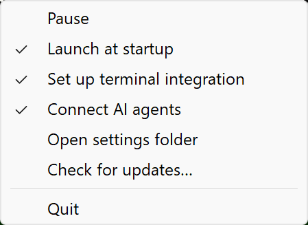

# 1. Install and first run

You need **Windows 11 (22H2 or newer, 64-bit)**.

## Install

1. Download `hytte.exe` from the [latest release](https://github.com/PrathamPai-2007/hytte/releases/latest).
2. Put it somewhere permanent that you can write to, such as `C:\Tools\Hytte\hytte.exe`. Avoid `Program Files`, because Hytte can't update itself there.
3. Double-click it. The pill appears at the top of your screen and an icon appears in the tray.

Windows may warn you the first time, because `hytte.exe` isn't code-signed. Choose **More info**, then **Run anyway**.

Hytte adds itself to your `PATH`, so the `hytte` command works in any terminal you open from now on. It also adds a Start Menu shortcut and starts with Windows. To stop that, untick **Launch at startup** in the tray menu.

## Finish setting up

Click the tray icon and choose what you use:

- **Set up terminal integration** shows your long-running commands on the pill ([page 3](03-terminal.md)).
- **Connect AI agents** shows Claude Code, Codex and others ([page 4](04-ai-agents.md)).

Then check everything in a **new** terminal:

```powershell
hytte doctor
```

It lists what's working and how to fix what isn't.

## Try it

1. Point at the pill. It opens.
2. Run `hytte run -- ping -n 6 localhost` and watch the task appear.
3. Drag a file to the top of the screen and drop it on the pill. Drag it back out when you want it.

## The tray menu



| Item | What it does |
|---|---|
| **Pause** | Hides the pill until you choose it again. |
| **Launch at startup** | Starts Hytte when you sign in. |
| **Set up terminal integration** | Adds Hytte to your shells. Choose it again to remove. |
| **Connect AI agents** | Adds Hytte to your agents. Choose it again to remove. |
| **Move to next monitor** | Moves the pill. Only listed with two or more monitors. |
| **Open settings folder** | Opens the folder with `config.toml` and `hytte.log`. |
| **Check for updates…** | Checks now. |
| **Help** | Opens this manual (version 2.0 and newer). |
| **Quit** | Closes Hytte. |

Next: [2. The pill](02-the-pill.md)
