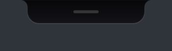
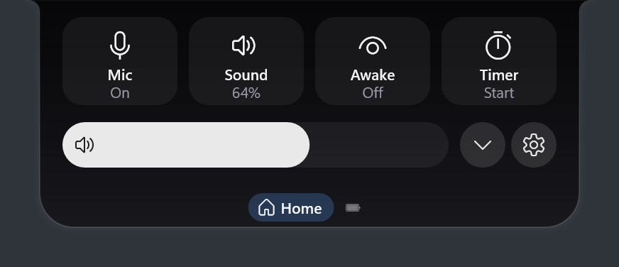
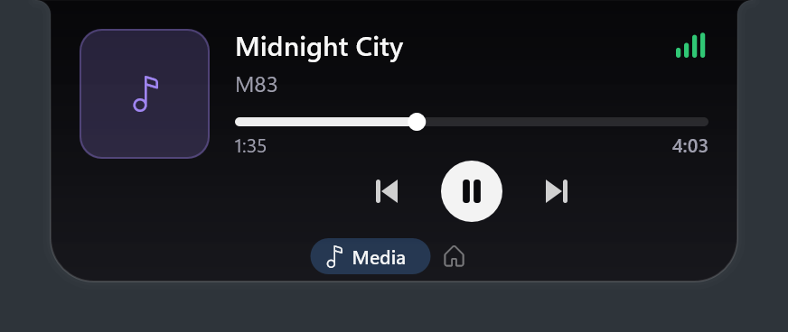
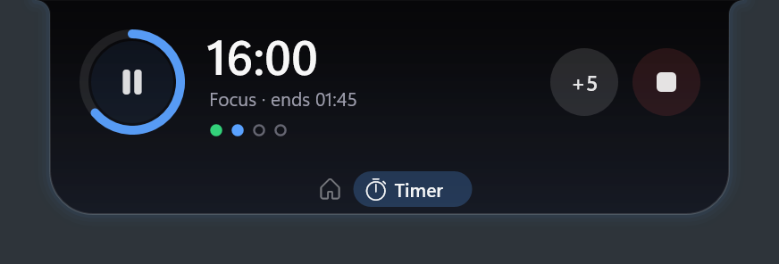

# 2. The pill

Hytte never takes keyboard focus on its own, so it won't interrupt your typing. The one exception is when you click a text field (Notes, To-do, the weather search) or press the Notes hotkey: then you can type, and **Esc** (or a click elsewhere) hands focus back to the window you were in.

## Opening and closing

Point at the pill and it opens. Move away and it closes. If you'd rather click, set **open on click** in [Settings](07-settings.md).

The pin in the row of icons keeps it open until you click the pin again. (Remove the pin with `pin_button = false` in [Settings](07-settings.md#editing-configtoml).)

## Panes

The icons along the bottom switch between panes. Only panes with something to show appear. You can switch any pane off and put them in your own order in [Settings](07-settings.md#choosing-and-ordering-panes).

| Pane | Shows |
|---|---|
| **Shelf** | Files you've parked. |
| **Media** | What's playing. |
| **Home** | Quick controls. Always there. |
| **Notes**, **To-do**, **Weather** | Things you type, and the forecast. See [Everyday tools](06-everyday-tools.md). You can hide any of them in [Settings](07-settings.md). |
| **Tasks** | Running commands, agents and dev servers. |
| **Timer** | A running timer. |
| **Power** | Battery and power mode, on laptops. |
| Your own panes | Whatever your scripts show, under the names you give them. See [Your terminal](03-terminal.md#your-own-panes). |

To switch panes, click an icon, swipe sideways on a touchpad, or turn the mouse wheel over the pill. A sideways swipe on the closed pill peeks at the next pane for three seconds.

Right-clicking the pill opens the timer card.

## What the pill is telling you

| You see | It means |
|---|---|
| Small dark capsule | Nothing is happening. |
| Spinner and timer | A task is running. |
| Green tick | A task finished. |
| Red cross | A task failed. It stays until you dismiss it. |
| Amber glow and a bell | Something, usually an AI agent, is waiting for you. Click it. |
| `● :3000` | A dev server is running on that port. |
| Stacked tiles and a number | Files are on your shelf. |
| Album art and moving bars | Music is playing. |
| Red lock | Microphones are muted. |
| Green / orange dot | An app is using your camera / microphone. |
| Small second pill | A running timer, or music while a task runs. |
| Amber `!` card | An app is using a lot of CPU or memory. |
| Blue `i` card | Your next meeting. |
| Battery that fills / drains | You plugged in / unplugged the charger. |
| Green bell card | A timer finished. |
| Small card with a ring, drop or figure | A break reminder: look away, drink, stretch. |
| Thin pale line along the pill | A focus session is running. |
| Thin grey line | A window is covering the pill's spot. Point at the line to bring it back. |

| Idle | Quick controls | Music | Timer |
|---|---|---|---|
|  |  |  |  |

## When the pill gets out of the way

| What's on screen | What Hytte does |
|---|---|
| A game, or any app that's truly fullscreen | Disappears completely and stops watching the mouse, so it costs no frames. It comes back when you leave, and notifications wait for you. |
| A maximised or snapped window | Shrinks to the thin line. |
| Fullscreen video | Shrinks to the thin line, so the controls around it stay clickable. |

New installs show the pill in screenshots. If you'd rather keep it out of screenshots, recordings and screen shares, switch on `hide_from_capture` ([Settings](07-settings.md#editing-configtoml)); installs from before 2.0 already have it on. Tokens or passwords in a command show as `•••` either way.

If a game isn't detected, or an app makes Hytte back off when it shouldn't, see [Settings](07-settings.md#fullscreen-apps-and-games).

## Using the keyboard

Set a `hotkey` in [Settings](07-settings.md#editing-configtoml) (for example `"Win+Alt+N"`), then press it to open the pill.

| Key | Does |
|---|---|
| Left / Right | Previous / next pane. |
| 1 to 9 | Jump to that pane. |
| Tab / Shift+Tab | Move between buttons. |
| Enter or Space | Press the highlighted button. |
| Esc or the hotkey | Close the pill and go back to your window. |

While you use the keyboard, a faint line at the bottom of the pill reminds you of these keys. With a hotkey set, the tray menu also has **Open with keyboard**, showing the chord.

Next: [3. Your terminal](03-terminal.md)
