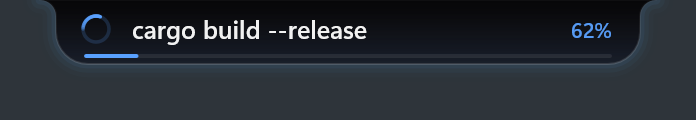
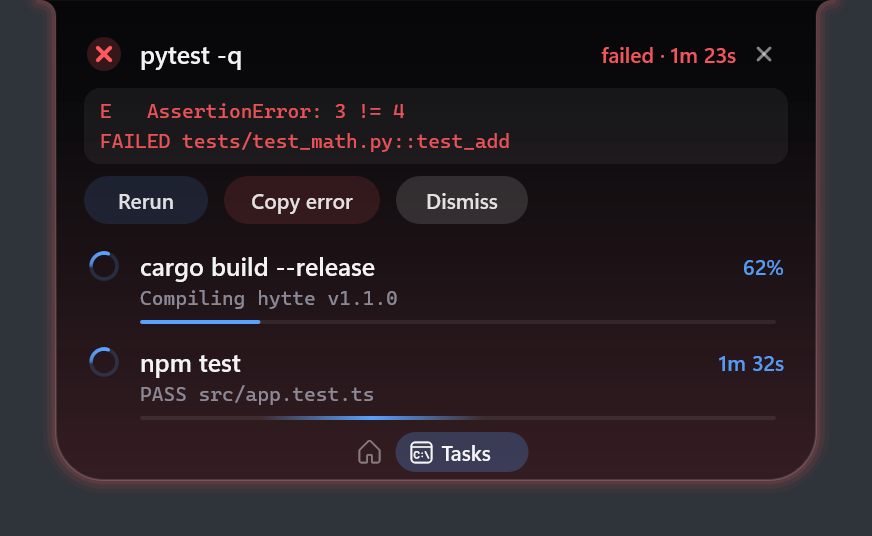

# 3. Your terminal



## Track every slow command

Tray → **Set up terminal integration** (or run `hytte setup`), then open a new terminal.

Anything that runs longer than 3 seconds now appears on the pill by itself. Editors and pagers such as `vim`, `less` and `ssh` are ignored. To remove the integration, choose the tray item again or run `hytte setup --undo`.

This sets up PowerShell and Git Bash. For zsh or Nushell, add one line yourself and open a new terminal:

| Shell | Line | File |
|---|---|---|
| PowerShell | `hytte init pwsh \| Out-String \| Invoke-Expression` | `$PROFILE` |
| bash / Git Bash | `eval "$(hytte init bash)"` | `~/.bashrc` |
| zsh | `eval "$(hytte init zsh)"` | `~/.zshrc` |
| Nushell | `hytte init nu \| save -f ~/.config/nushell/hytte.nu`, then `source` it | `config.nu` |

If PowerShell says scripts are disabled, run this once:

```powershell
Set-ExecutionPolicy -Scope CurrentUser RemoteSigned
```

If you use Starship, put the line *before* `starship init` in bash and *after* it in PowerShell.

## Track one command

Put `hytte run --` in front of it:

```powershell
hytte run -- npm run build
```

Your command runs as normal and keeps its exit code. Compared with automatic tracking, you also get:

- **A real progress bar**, when the output has a percentage (`45%`) or a step count (`[12/345]`). Use `--no-progress` to ignore those.
- **The latest output line** under the task.
- **Copy error**, with the end of the output when it fails.

Some tools only print progress in a real terminal, so ask for it: `hytte run -- git clone --progress <url>`.

## What you can do with a task



- **Click a task** to jump to its terminal, including the right Windows Terminal tab.
- **Rerun** a failed command.
- **Copy error** from a failed `hytte run` command.

A command you stop with Ctrl+C doesn't count as failed.

## Use Hytte from your own scripts

```powershell
hytte set --progress 40 --label "Uploading" --task upload-1   # same --task updates one entry
hytte set --done --label "Uploading" --task upload-1          # green tick (--fail for a red cross)
hytte notify "Backup finished"                                # a card on the pill
hytte shelf add .\report.pdf                                  # or: git diff | hytte shelf add
hytte ports                                                   # list dev servers
hytte kill :3000                                              # stop what's on port 3000 (asks first)
```

### Live cards

A card that keeps up with your script: a progress bar, an icon and buttons.

```powershell
hytte card --id deploy --title Deploy --body "Uploading..." --progress 40
hytte card --id deploy --body "Almost there" --progress 90   # same --id: updates it
hytte card --id deploy --done --body Live                    # tick, full bar
hytte card --title "CI failed" --icon error --open https://ci.example.com
```

To ask a question, add buttons and `--wait`. The command waits until you press one, prints its name, and exits 0. If you don't answer, it exits 1 when the card goes (after a minute, or `--ttl` seconds).

```powershell
$answer = hytte card --title "Restart the server?" --button Restart --button Later --wait
if ($answer -eq "Restart") { npm run restart }
```

The buttons only tell your script what you pressed. They never run anything themselves. `hytte card --help` lists every option.

## Your own panes

Add up to four panes of your own in `config.toml` (Tray → **Open settings folder**):

```toml
[[script_pane]]
name = "Server"
command = "curl -s localhost:3000/health"
every = 300          # seconds between runs, 30 at least

[[script_pane]]
name = "Deploys"     # no command: your scripts fill it
```

A pane with a `command` runs it, hidden, while the pane is open (and once when Hytte starts), and shows the first six lines it prints. A command that fails shows in amber with its exit code; one that takes longer than 10 seconds is stopped. Nothing runs while the pane is closed.

Any script can also send a pane text:

```powershell
hytte pane set Deploys --text "web v2.0.0 live"
git log -3 --oneline | hytte pane set Deploys
```

The pane shows that text until its next run or the next `hytte pane set`. Each pane has a switch in [Settings](07-settings.md#choosing-and-ordering-panes) and can be moved along the tab strip.

### Rows and buttons

A pane (and `hytte pane set --json`) can print JSON instead of text:

```json
{"rows": [
  {"text": "api", "value": "up 3d", "tone": "good", "action": "restart-api"},
  {"text": "disk", "value": "82%", "progress": 82, "tone": "warn"}
]}
```

Up to six rows, each with `text` or `value` (or both), a `progress` bar (0 to 100), a `tone` (`good`, `warn`, `bad`) and an `action`. Anything that isn't valid rows shows as plain text, as before.

An `action` names an `[[action]]` in `config.toml`; clicking the row runs it:

```toml
[[action]]
name = "restart-api"
command = "docker restart api"
confirm = true      # the first click says "Sure?", the second runs it
timeout = 60        # seconds before it is stopped, with everything it started
```

A card button can run one too: `hytte card --title "api is down" --button "Restart:restart-api" --button Later`. A card tells you how it went. A script can press only the buttons you wrote: nothing it sends can name a command of its own.

### Pane packs

A folder in `%APPDATA%\Hytte\panes\` with a `pane.toml` is a ready-made pane with its own actions. Copy one in and Hytte shows a card with the command and **Run** / **Ignore**; nothing runs until you press Run, and editing the folder asks again. Three examples (your pull requests, Docker containers, CI status) are in the repository's `examples/panes/` folder. Packs share the four-pane limit; your own `[[script_pane]]`s come first.

Next: [4. AI agents](04-ai-agents.md)
