# 6. Everyday tools

## Quick controls

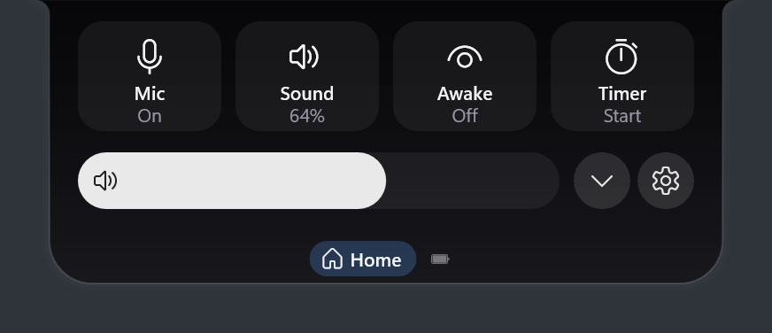

The Home pane has four tiles, a volume bar and the settings gear.

| Control | Does |
|---|---|
| **Mic** | Mutes every microphone. A red lock stays on the pill. |
| **Sound** | Mutes your speakers. Scroll over it to change the volume. |
| **Awake** | Keeps the PC awake. Click to cycle: off, one hour, on. |
| **Timer** | Opens the timer card. |
| Volume bar | Drag or scroll to change the volume. |
| ▾ on the volume bar | Shows a volume bar for each app making sound. |

## Music

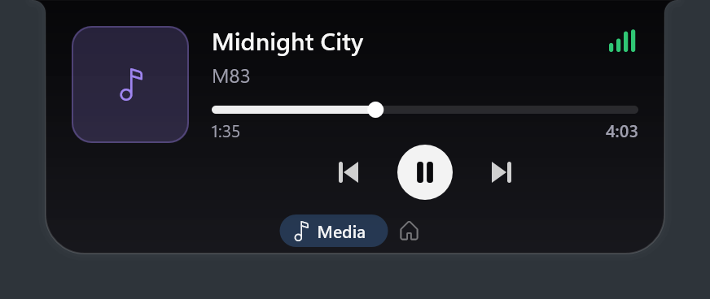

The Media pane controls whatever is playing, as long as the player reports itself to Windows (most browsers and players do). Drag the timeline to seek, and click the album art to raise the player. The **Lyrics** button and the moon (a sleep timer) are described just below.

## Timer and focus sessions

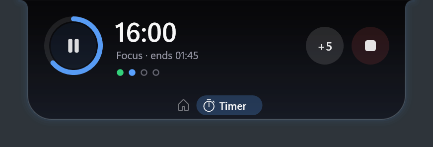

1. Home → **Timer**, or right-click the pill.
2. Pick the minutes. Scrolling works here too.
3. Choose **Start timer** for a plain countdown, or **Start focus** for focus sessions with breaks.

While the pill is closed, the timer burns down as a thin fuse along it (a focus session shows a quieter line, see [Focus mode](#focus-mode)). Click the ring to pause. A timer survives a restart.

When it ends, an alarm rings for up to two minutes. Choose **Stop alarm** or **+5 min**. After a focus session, Hytte offers your break: 5 minutes, with a 15-minute long break every second round. You can change these in [Settings](07-settings.md).

## Lyrics and the sleep timer

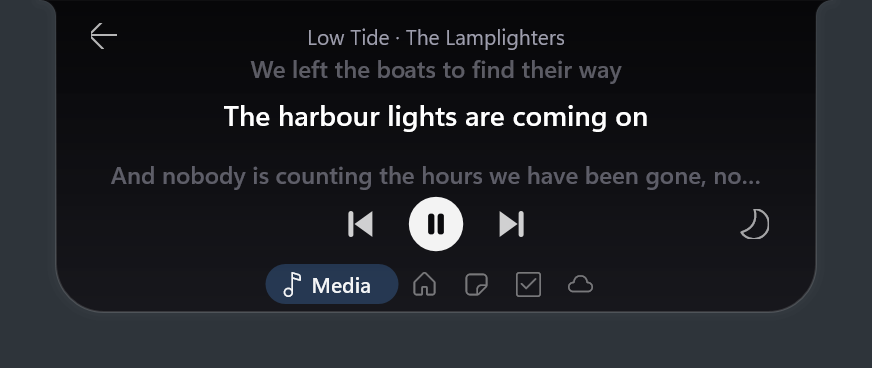 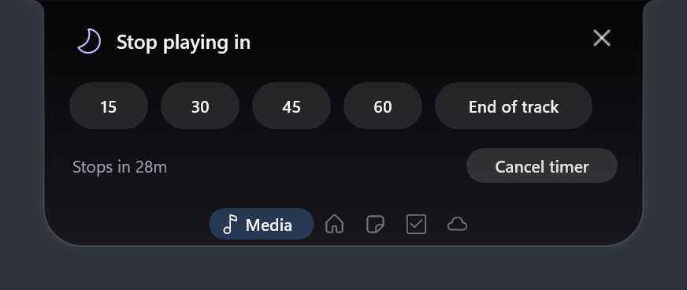

**Lyrics.** Click **Lyrics** on the Media pane. The page shows the line being sung with the line before and after. They are on for new installs (older installs keep their setting; the page has a **Turn on** button, and there is a switch in [Settings](07-settings.md)). Looking a song up sends its title and artist to [lrclib.net](https://lrclib.net), a free lyrics database, so switch lyrics off if you would rather not. Nothing is looked up unless the page is open, and Hytte keeps lyrics only in memory, for the last 20 songs.

Lyrics are not looked up for video and photo apps (Photos, Movies & TV, Windows Media Player, VLC, mpv, PotPlayer, Netflix and similar): the page says so and nothing is sent. Browsers are not skipped, so a video tab may find nothing.

With timed lyrics the lines glide smoothly from one to the next. The **Live** tick box at the bottom left turns that off, so you see the words to scroll through instead (the choice is kept; it is `[media] lyrics_live`). **Live** is greyed out and does nothing for songs that have no timed lyrics.

If the database has the words but for a different recording of the song, you see them without timing, scrolling with the mouse wheel. A touchpad moves one line per long stretch of two-finger scroll, so the page doesn't fly past.

**Sleep timer.** Click the moon, then pick 15, 30, 45 or 60 minutes, or **End of track**. In the last 20 seconds the volume of that player fades out, then it pauses, then its volume is put back, so tomorrow's first song isn't silent. Pausing yourself doesn't cancel it. Click the moon again to cancel. Closing Hytte forgets the timer.

## Focus mode

Choose **Start focus** on the timer card.

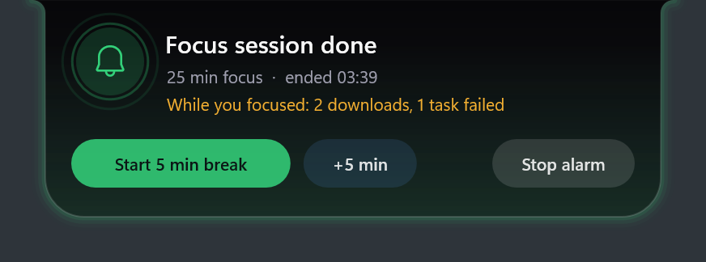

During a session:

- **Windows Do Not Disturb is on**, and goes back to how it was when the session ends. If Hytte closes unexpectedly, it is put back the next time Hytte starts. Hytte uses a Windows setting Microsoft doesn't document, so a Windows update could stop this working. Hytte then still does the next two things. Turn it off with `[timer] focus_dnd = false`.
- **Hytte keeps quiet too.** Finished downloads, finished tasks, agent reply cards and CPU warnings wait. When the session ends, one line tells you what you missed ("While you focused: 2 downloads, 1 task failed"). Things that need you still come through: an agent asking permission, the timer itself, and your next meeting.
- **The pill shows a thin pale line** instead of the bright fuse. It turns amber in the last minute.

## Notes

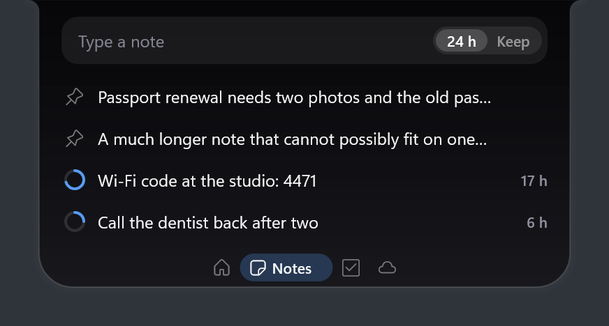

Click the field, type, press **Enter**. The **24 h / Keep** switch decides how long the note stays: a ring shows the time left, and **Keep** (a pin button when you point at a note) keeps it for good. Point at a note for **Copy**, **Keep** and **Delete** (Delete offers **Undo** for a few seconds). Click a note's text to change it.

Set a `note_hotkey` in [Settings](07-settings.md#editing-configtoml) (for example `"Win+Alt+J"`) to open Notes with the cursor ready, from any app. **Esc** takes you straight back. Notes live in `%APPDATA%\Hytte\jot.json` on your PC and nowhere else.

## To-do

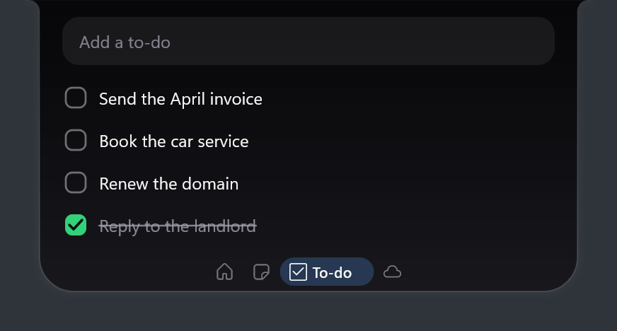

The same field adds a to-do. Click the box to tick it: it moves to the bottom and leaves after 24 hours. Click the text to change it; point at a row to delete it.

## Weather

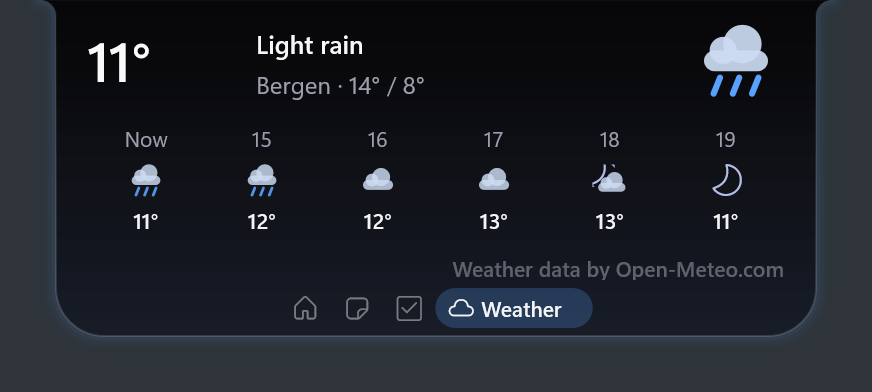 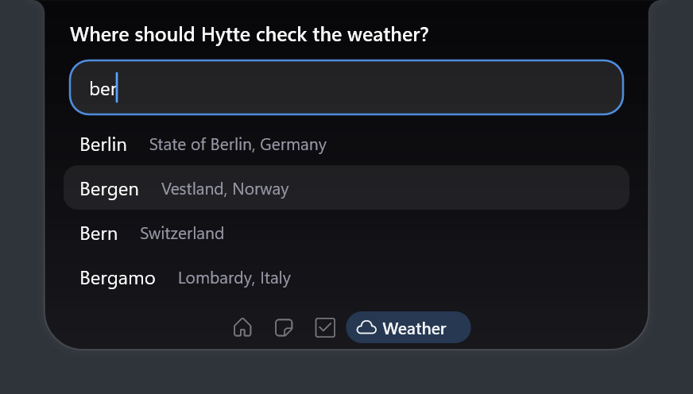

The first time, the pane asks where to check. Type a town and suggestions appear as you type; use the arrow keys and **Enter**, or click one. You then see the temperature now, today's high and low, and the next five hours. Click the town's name to choose another place.

Not finding your town? If nothing matches for about two seconds, a row appears: **Search more widely for "your town"**. Click it (or press **Enter**) and Hytte asks [OpenStreetMap](https://www.openstreetmap.org) once, which knows many smaller places. Its answers are listed with a credit line, and the same search isn't repeated in a session. Nothing is sent to OpenStreetMap unless you click.

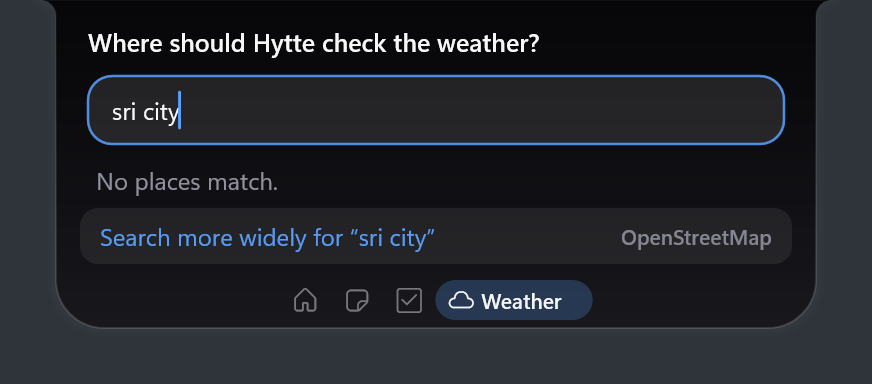

Weather is fetched only when you open the pane and what Hytte has is over 30 minutes old, so a closed pill makes no requests. It comes from [Open-Meteo](https://open-meteo.com) (free for non-commercial use, which is why the pane credits it). Searching sends what you type to Open-Meteo; the forecast sends the town's coordinates. Hytte keeps your place in `place.json` and asks Windows for nothing. Temperatures follow your Windows measurement setting, or `[weather] units`.

## Break reminders

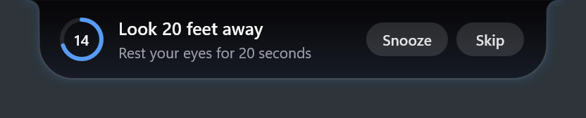

Off until you choose how often, in the **Breaks** section of the settings window: an **eye break** (the 20-20-20 rule: look 20 feet away for 20 seconds, with a countdown), a **stretch** reminder and a **water** reminder. Each shows as a small card on the pill, with **Snooze** (ten minutes) and **Skip**. There is no sound and no popup.

Reminders wait during a focus session, a camera or microphone call, quiet hours, fullscreen and games, while a card is up, and while you are using the pill (pointing at it or typing in it). A reminder that waited shows once, when the way is clear. Five minutes away from the PC counts as a break and restarts the clocks. Two reminders never come back to back.

## Dev servers

Anything listening on a common port (`3000`, `5173`, `8080` and others) appears under **SERVERS** in the Tasks pane. Servers are named after their project folder.

- **Open** opens it in your browser.
- **Stop** stops it, and asks twice.
- **Restart** appears for a server you started from a tracked command.

To list another port, add it to `watch`, or set `show_all = true` ([Settings](07-settings.md#editing-configtoml)).

## Alerts

| Alert | Buttons | Turn it off |
|---|---|---|
| **Browser downloads** show as tasks, then a finished card. | **Open**, **Shelve** | `[downloads] enabled = false` |
| **Resource hogs:** an app using over 70 % of the CPU for 30 seconds, or over 4 GB of memory. | **Kill** (asks twice), **Ignore** | `[hog] enabled = false` |
| **Next meeting**, 10 minutes before it starts. Off by default, because titles are private. | **Join**, when there's a link | Turn on with `[calendar] enabled = true` |
| **Camera and mic dots** while an app uses them. | | Always on |
| **Camera or microphone starts:** a 3-second card naming the app (not when it stops; not during Focus or quiet hours). | | `[moments] privacy = false` |
| **A Bluetooth device connects:** "Pixel Buds connected", with its battery when it reports one. | | `[moments] bluetooth = false` |

If another card is showing when an alert arrives, it waits its turn instead of being lost. A card that has waited over 30 seconds is dropped.

## Battery

On laptops, the Power pane shows your charge and time left, and lets you switch between **Saver**, **Balanced** and **Performance**.

Next: [7. Settings](07-settings.md)
