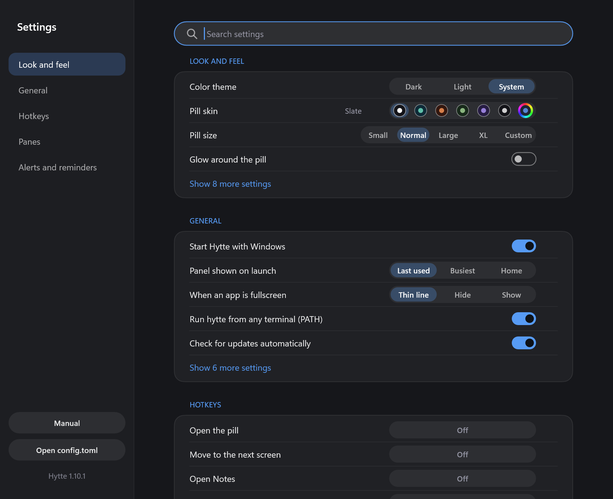

# 7. Settings

## The settings window

Click the **gear** on the Home pane (or, if you have hidden Home, the tray icon → **Settings…**). It opens the settings window, which has every switch and slider.

- **Type** to search.
- **Rest the pointer** on a setting for an explanation.
- **Custom** opens `config.toml` at that setting, for a value the presets don't have.
- **↺** puts a changed setting back to its default.

### Choosing and ordering panes

The **Panes** section lists every pane: Quick controls, Music, Shelf, Terminal tasks, Coding agents, Timer, Battery, Notes, To-do, Weather and Ask (local AI, which appears once you switch it on in the **Ask (local AI)** section). Each has a switch (the Quick controls say **Always on**: they are where the pill starts), and the **▲ ▼** buttons move it along the tab strip. Panes that only appear when they have something to show (Music, Shelf, Timer, Battery, Terminal tasks) keep their place in the order for when they do. Your own [script panes](03-terminal.md#your-own-panes) and the example packs you have approved are listed under their own names (a pane from `config.toml` first, then approved packs, up to four in all), each with the same switch and **▲ ▼**. The switch belongs to the slot, so approving or ignoring a pack that sits ahead of another can move their switches; check them after changing packs.

### Skin and glow

The **Accent** skin, the sixth colour disc, follows your Windows accent colour (Settings → Personalisation → Colours). With the accent on **Automatic**, Windows picks it from your wallpaper, and the pill changes with it.

The last disc, **Custom** (the one with the rainbow rim), is a colour you choose. Two sliders appear under the discs: **Skin colour** (a rainbow) and **Vividness** (from nearly grey to the full colour). The colour is saved when you let go. Hytte keeps the pill dark (or light, in light mode) whatever you pick, so text stays readable: a bright yellow becomes a deep yellow-tinted pill, not a yellow one. You can also type a colour into `config.toml` as `skin = "#3a6ea5"`.

The glow around the pill is off at first. Switch on **Glow around the pill** to have it; **Glow strength** starts at 70 %, and dragging it also switches the glow on.

### Hotkeys

The **Hotkeys** section sets four key combinations that work from any app: **Open the pill** (to use it with the keyboard), **Move to the next screen**, **Open Notes** and **Open Ask** (those two need their pane switched on). Click a row's field, then press the keys, for example **Win + Alt + J**. A hotkey needs Ctrl, Alt, Shift or Win plus a letter, a digit or F1 to F24. **Esc** cancels, **Backspace** turns the hotkey off. If another app already uses the combination, it shows in amber with **Taken by another app**: pick a different one.



## Editing config.toml

Lists and folders are only in the file. Tray → **Open settings folder**, then open `config.toml`.

Every setting is optional and most apply as soon as you save. If you make a mistake, Hytte keeps your previous settings and shows a card with the line and column.

```toml
[general]
theme = "auto"            # "dark", "light" or "auto"
monitor = "primary"       # "primary", "active", "cursor" or a number
hotkey = ""               # e.g. "Win+Alt+N": opens the pill for keyboard use (or Settings → Hotkeys)
monitor_hotkey = ""       # e.g. "Win+Alt+M": moves the pill to the next monitor
open_on = "hover"         # or "click"
fullscreen = "line"       # "line", "hide" or "off" (games always hide unless "off")
hide_from_capture = false # true keeps the pill out of screenshots and screen share
quiet_hours = ""          # no sounds, e.g. "22:00-07:00"
note_hotkey = ""          # e.g. "Win+Alt+J": opens Notes with the cursor ready
skin = "graphite"         # "graphite", "aurora", "ember", "moss", "dusk", "accent" or a colour like "#3a6ea5"
output_folder = 'C:\Users\you\Hytte output'  # where file actions save; leave out to save next to the file
allow_list = []           # apps that never make Hytte back off
deny_list = []            # apps that always count as a game

[shell]
threshold_ms = 3000       # how long a command must run before it shows

[shelf]
mode = "reference"        # or "copy": keep a copy in Hytte's own folder

[ports]
watch = [3000, 3001, 4200, 5000, 5173, 5432, 8000, 8080, 8888]
show_all = false

[calendar]
enabled = false           # off by default: event titles are private

[panes]
media = true               # switch any pane's tab off here
shelf = true
tasks = true
timer = true
power = true
notes = false             # Notes, To-do and Ask start switched off
todo = false
weather = true
ask = false
order = ""                # tab order, set by the arrows in the settings window

[weather]
units = "auto"            # "auto" (follow Windows), "metric" or "imperial"

[media]
lyrics = true             # looks songs up on lrclib.net (sends title and artist)
lyrics_live = true        # follow the song line by line when the lyrics are timed

[breaks]
eyes_min = 0              # minutes between reminders; 0 = off
stretch_min = 0
water_min = 0

[timer]
focus_dnd = true          # a focus session turns on Windows Do Not Disturb
```

A hotkey needs at least one of `Win`, `Ctrl`, `Alt` or `Shift`, plus one key.

## Fullscreen apps and games

Use exe names in the two lists:

```toml
deny_list = ["MyGame.exe"]   # a game Hytte didn't detect
allow_list = ["Code.exe"]    # never hide or shrink for this app
```

`hytte.log` records what Hytte decided, if you need to find out why it hid.

For the complete list of settings, see the [configuration guide](../docs/11-configuration-and-files.md#every-setting).

Next: [8. Updates and troubleshooting](08-updates-and-troubleshooting.md)
