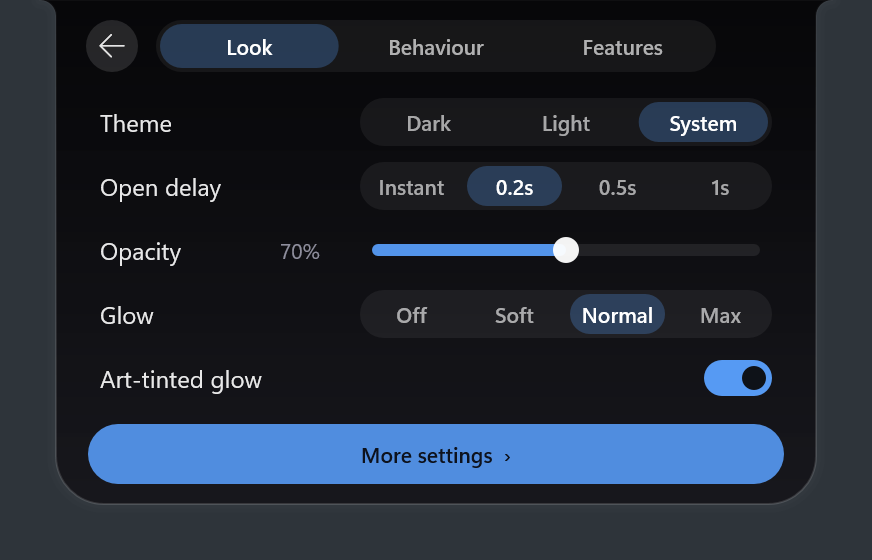
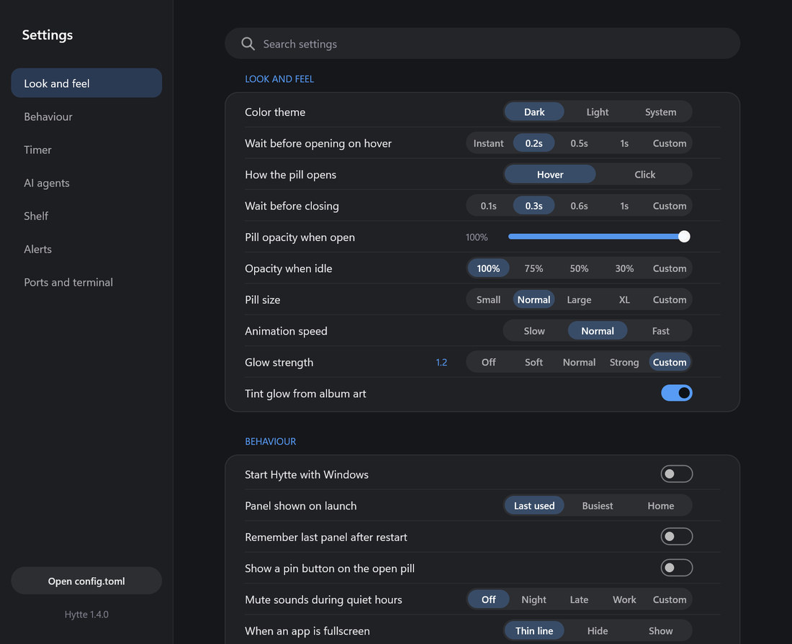

# 7. Settings

## The settings pane

Click the **gear** on the Home pane. The pane covers the common settings, such as theme, opacity, glow and feature switches.



## The settings window

The button at the top right of the pane opens the full window. It has every switch and slider.

- **Type** to search.
- **Rest the pointer** on a setting for an explanation.
- **Custom** opens `config.toml` at that setting, for a value the presets don't have.
- **↺** puts a changed setting back to its default.



## Editing config.toml

Lists, the hotkey and folders are only in the file. Tray → **Open settings folder**, then open `config.toml`.

Every setting is optional and most apply as soon as you save. If you make a mistake, Hytte keeps your previous settings and shows a card with the line and column.

```toml
[general]
theme = "auto"            # "dark", "light" or "auto"
monitor = "primary"       # "primary", "active", "cursor" or a number
hotkey = ""               # e.g. "Win+Alt+N": opens the pill for keyboard use
monitor_hotkey = ""       # e.g. "Win+Alt+M": moves the pill to the next monitor
open_on = "hover"         # or "click"
fullscreen = "line"       # "line", "hide" or "off" (games always hide unless "off")
hide_from_capture = false # true keeps the pill out of screenshots and screen share
quiet_hours = ""          # no sounds, e.g. "22:00-07:00"
note_hotkey = ""          # e.g. "Win+Alt+J": opens Notes with the cursor ready
skin = "graphite"         # "graphite", "aurora", "ember", "moss" or "dusk"
output_folder = 'C:\Users\you\Hytte output'  # where file actions save; leave out to save next to the file
allow_list = []           # apps that never make Hytte back off
deny_list = []            # apps that always count as a game

[shell]
threshold_ms = 3000       # how long a command must run before it shows

[shelf]
mode = "reference"        # or "copy": keep a copy in Hytte's own folder

[ports]
watch = [3000, 3001, 4200, 5000, 5173, 5432, 8000, 8080, 8888]
show_all = false

[calendar]
enabled = false           # off by default: event titles are private

[panes]
notes = true              # switch a pane's tab off here
todo = true
weather = true

[weather]
units = "auto"            # "auto" (follow Windows), "metric" or "imperial"

[media]
lyrics = false            # looks songs up on lrclib.net

[breaks]
eyes_min = 0              # minutes between reminders; 0 = off
stretch_min = 0
water_min = 0

[timer]
focus_dnd = true          # a focus session turns on Windows Do Not Disturb
```

A hotkey needs at least one of `Win`, `Ctrl`, `Alt` or `Shift`, plus one key.

## Fullscreen apps and games

Use exe names in the two lists:

```toml
deny_list = ["MyGame.exe"]   # a game Hytte didn't detect
allow_list = ["Code.exe"]    # never hide or shrink for this app
```

`hytte.log` records what Hytte decided, if you need to find out why it hid.

For the complete list of settings, see the [configuration guide](../docs/11-configuration-and-files.md#every-setting).

Next: [8. Updates and troubleshooting](08-updates-and-troubleshooting.md)
