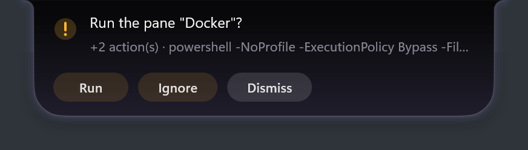
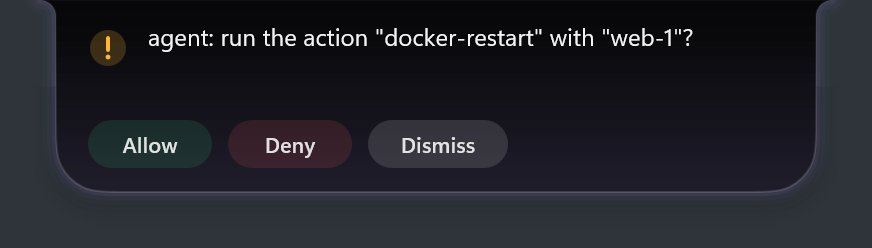

# 11. The pane store

Ready-made panes you can install with one command, and what happens when an AI agent wants to add a pane or run something for you.

## Installing a ready-made pane

Open a terminal and type:

```powershell
hytte pack search            # see what is available
hytte pack info docker       # see exactly what a pane will run
hytte pack install docker    # download it
```

Hytte then shows a card on the pill with the pane's command and two buttons, **Run** and **Ignore**. **Nothing runs until you press Run.** A new tab appears once you do. (**Dismiss** just hides the card for now; it asks again the next time Hytte starts.)



The card shows the start of the command, after a note such as "+2 action(s)" when the pane has extra buttons. A long command from the store is cut off, so use `hytte pack info <name>` to read all of it.

Before you press Run, take a minute to read what it does: `hytte pack info <name>` prints the commands. Your Run covers the pane's settings file. It does not cover the scripts next to it, so open the pack's folder (`%APPDATA%\Hytte\panes\<name>`) if you want to read those too.

## Keeping them up to date, or removing them

```powershell
hytte pack list              # what you installed
hytte pack update            # bring them all up to date
hytte pack update docker     # just one
hytte pack remove docker     # take it away
```

- An update **asks you again** (you get the Run / Ignore card again), because an update can change what runs.
- Files you added yourself to a pack's folder (for example a `repo.txt`) are never touched by update or remove.
- `hytte pack remove` only removes packs that `hytte pack install` made. A pane you copied in by hand is yours: delete its folder to remove it.

## Is it safe?

Hytte checks every downloaded file against a fingerprint (SHA-256) listed in the index. If a single byte is different, nothing is installed. After that, the Run button is your safeguard, the same as for any pane. Only press Run on things you understand or trust.

## Using another collection

`--source` points at a different list: a web address (`https://...`) or a folder on your PC that contains an `index.json`.

```powershell
hytte pack search --source C:\my-panes
```

## When an agent wants to add a pane or run something

If you used `hytte setup mcp`, an agent can do more than show cards. Here is what it can do, and what it has to ask you first.

| The agent can... | What you see |
|---|---|
| List your panes and the names of your actions | Nothing. It only reads names, never commands. |
| Read what a pane shows, whether an agent is waiting for you, or what happened lately | Nothing. It only looks at what the pill already shows. |
| Show a card, a note or a to-do, or fill one of your panes | The card, note or to-do, as before. |
| Make a pane (up to four) | The **Run / Ignore** card with the command it chose. The command can be at most 60 characters, so you see all of it. Nothing runs until you press Run. |
| Change or remove a pane **it made** | The same card again after a change. It can never change or remove your own panes. |
| Run one of your actions | **"agent: run the action X?"** with **Allow** and **Deny**, every time. No answer in 30 seconds counts as no. |



**Dismiss** counts as no, the same as waiting 30 seconds. An agent cannot run any command it makes up: only an action that already exists in your `config.toml` or in an approved pane. It can ask at most ten times a minute.

### Letting one action run without asking

If an agent runs the same safe action all day, you can allow just that one in advance, from a terminal:

```powershell
hytte mcp grant docker-restart    # shows the command you are allowing
hytte mcp grants                  # what is allowed in advance
hytte mcp revoke docker-restart   # ask every time again
```

If the action's command ever changes, you are asked again. An agent cannot do this for itself: it only works from a terminal you typed into.

Everything an agent changes or tries to run is written to `%APPDATA%\Hytte\mcp.log`, one line each, so you can look afterwards.

One honest limit: these checks stop an agent that only has Hytte's tools. A program that already runs on your PC as you could do those things without Hytte, so keep your usual care about what you let run.

## If something goes wrong

| Problem | Fix |
|---|---|
| `download failed ... 404` | The online list is not available (yet). Try again later, or use `--source` with a folder. |
| `... needs Hytte 1.x or newer` | Update Hytte first ([page 8](08-updates-and-troubleshooting.md)). |
| `does not match the index` | The download was changed or damaged. Nothing was installed. Try again; if it keeps happening, do not install it. |
| `already exists and was not installed by hytte pack` | You have a folder of that name. Hytte leaves it alone. Rename or delete it if you want the downloaded one. |
| The Run card never appeared | Check Settings → Panes (there is room for 12 custom panes), and that Hytte is running. |

Back to the start: [Hytte manual](README.md)
